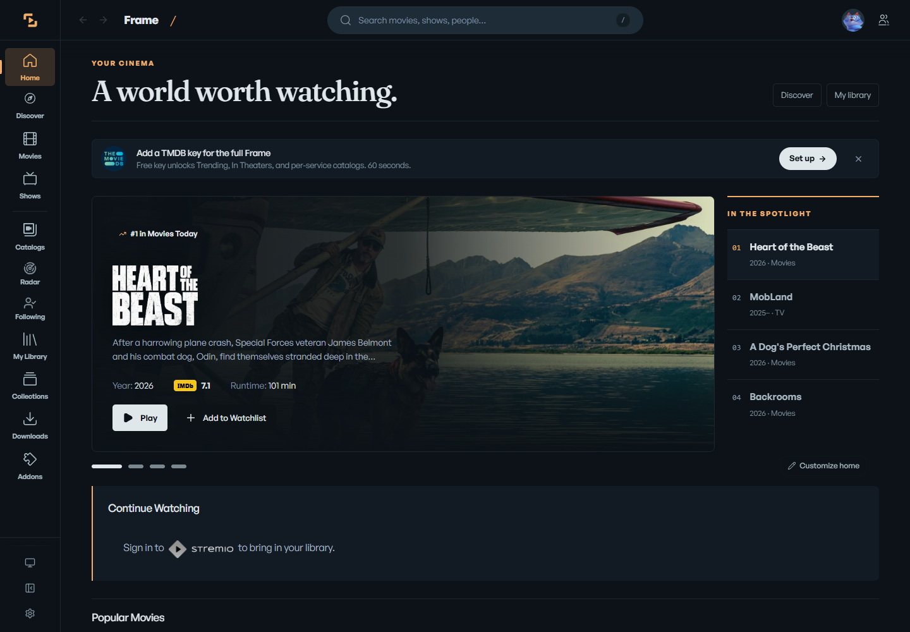
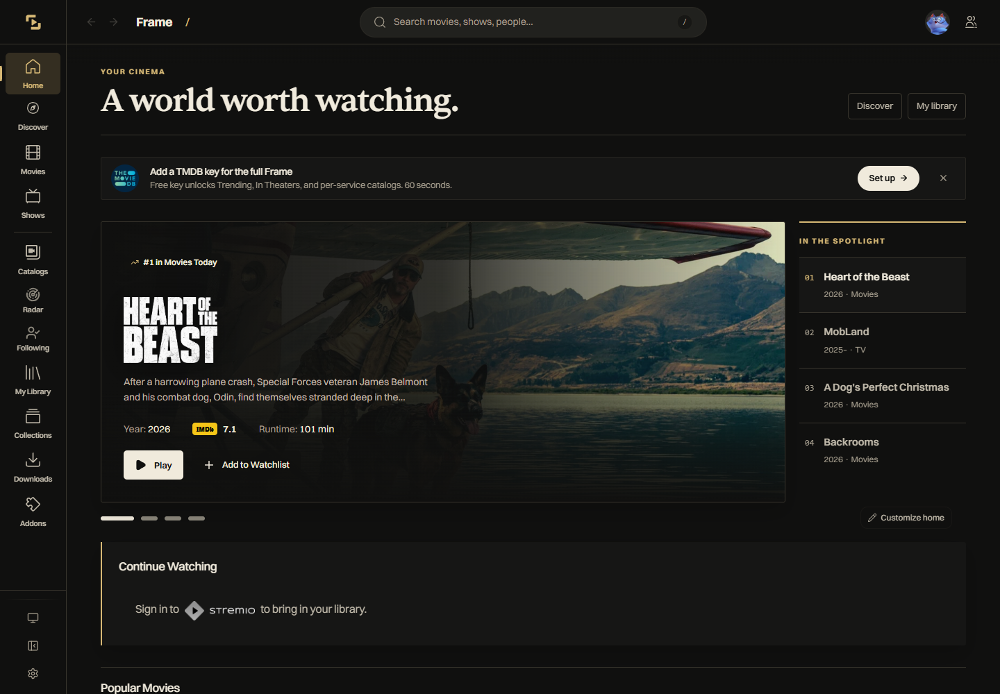
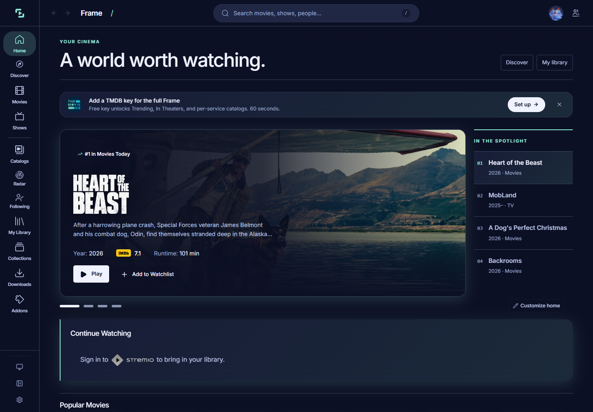
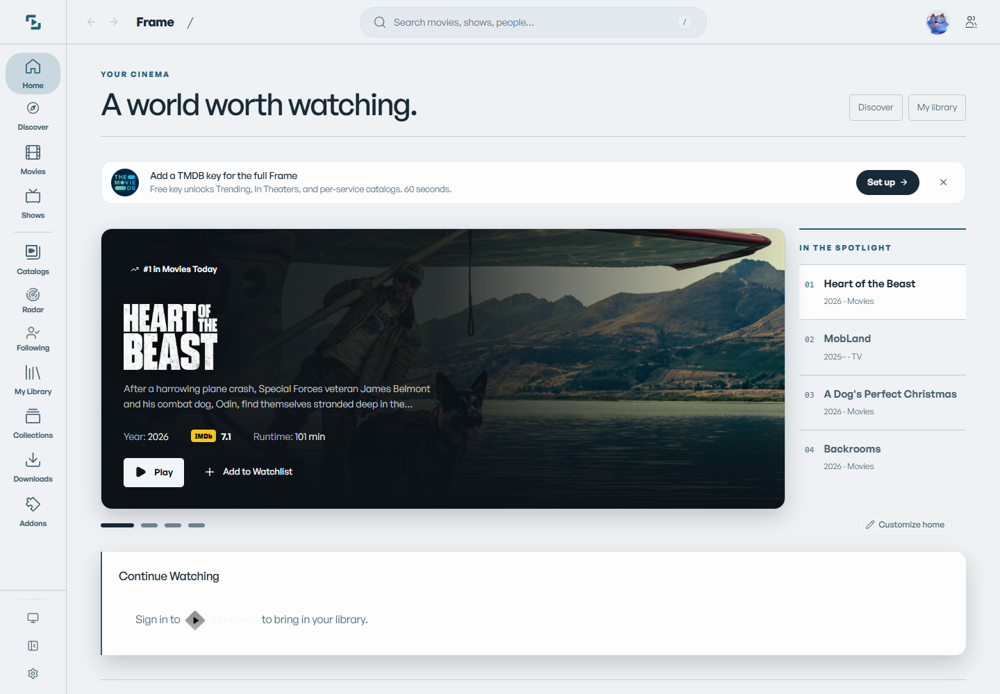
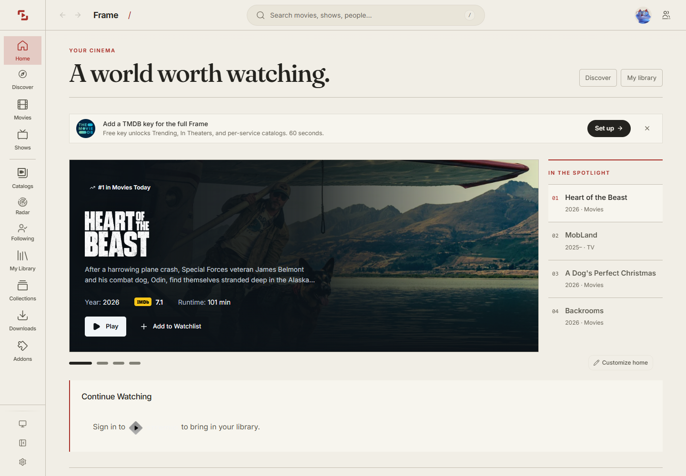
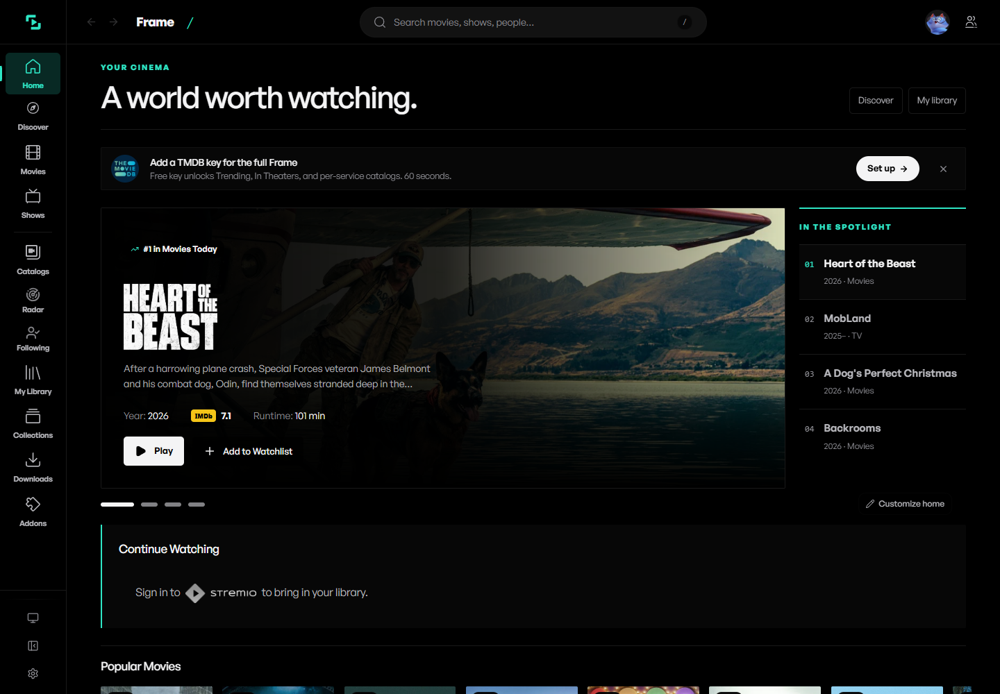
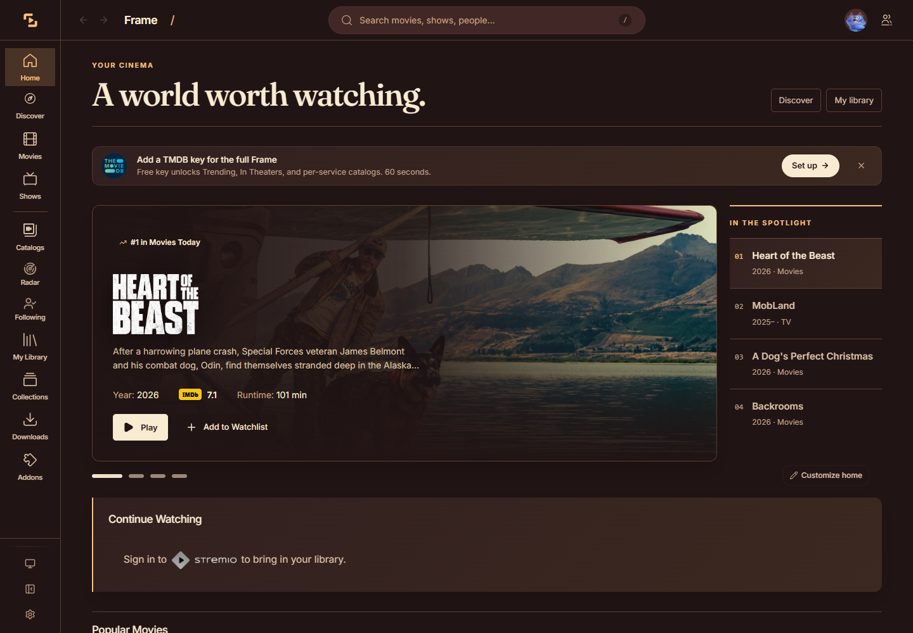
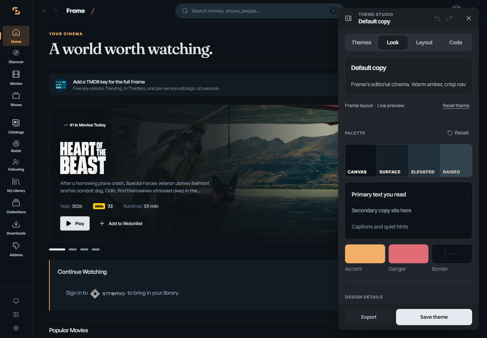

<div align="center">

# Frame

**Your media, your space.**

A personal Windows desktop app for discovering, organizing and watching movies and TV.
Powered by Tauri 2, React, TypeScript, Rust and libmpv.

[**Download Frame for Windows**](https://github.com/A67med/Frame/releases/latest) · [Explore themes](#make-it-yours) · [Features](#what-you-can-do) · [Build from source](#build-from-source)




_The redesigned Frame desktop — browse your collection, find your next watch and make every screen your own._

</div>

---

## What's new in v0.4.0

**Theme Studio, reinvented.** Default now stays in the Frame layout while you're editing and previewing it. Seven distinct modern themes, richer design controls, reliable live previews, undo/redo, and separate options to update a custom theme or save a new copy.

- **Frame layout everywhere it belongs.** Default, modern presets, previews and saved copies use the same explicit layout. Existing classic themes retain their original design.
- **Design the details.** Adjust typography, spacing, corner radius, solid/glass/gradient surfaces, elevation and navigation treatment.
- **Keep control.** Search the theme collection; reset, undo and redo; import and export your work as a `.framestyle` file.
- **Save with confidence.** Edit without duplicate themes, or use **Save as a new theme**. Draft and saved appearance now agree.

[Read the Theme Studio guide](docs/THEME-STUDIO.md) · [See verification screenshots](docs/theme-studio-evidence/README.md) · [View the v0.4.0 release](https://github.com/A67med/Frame/releases/tag/v0.4.0)

## Make it yours

<div align="center">

|                                                  Default                                                   |                                                  Noir Cinema                                                   |
| :--------------------------------------------------------------------------------------------------------: | :------------------------------------------------------------------------------------------------------------: |
|  |  |
|                                     Graphite, amber, editorial detail                                      |                                          Cinematic charcoal and brass                                          |

|                                                         Aurora                                                         |                                                      Minimal Frost                                                      |
| :--------------------------------------------------------------------------------------------------------------------: | :---------------------------------------------------------------------------------------------------------------------: |
|  |  |
|                                              Deep blue, violet, soft glow                                              |                                              Clean, bright and translucent                                              |

|                                                      Editorial                                                      |                                                  OLED Black                                                   |
| :-----------------------------------------------------------------------------------------------------------------: | :-----------------------------------------------------------------------------------------------------------: |
|  |  |
|                                            Warm paper, ink, red accents                                             |                                        True black, minimal decoration                                         |



**Retro Cinema** — expressive type, oxblood, cream and amber.

</div>

> **Classics are still here.** Stremio, Royal and Velvet remain available with their original layouts. Your existing imported themes are not silently converted.

<details>
<summary><strong>How do I customize a theme?</strong></summary>

1. Open **Settings → Appearance → Your themes**.
2. Choose **Customize theme** or **Open studio**.
3. Pick a preset in **Themes**, then use **Look**, **Layout**, and **Code** to make it yours.
4. Use **Save changes** for a custom theme or **Save as a new theme** for a separate copy. Built-in presets save as user themes.

Reset and undo/redo work on your current draft. You can export your theme and import it again later.

</details>

## What you can do

| Explore                                                                                 | Play and organize                                                                                   | Personalize                                                                                                     |
| --------------------------------------------------------------------------------------- | --------------------------------------------------------------------------------------------------- | --------------------------------------------------------------------------------------------------------------- |
| **Home, Discover, Movies & TV** — browse titles, artwork, filters and global search.    | **Native mpv playback** — local files, subtitles, resume, skip intro/outro and picture-in-picture.  | **Theme Studio** — seven modern presets, detailed design controls, custom CSS, HTML and optional JavaScript.    |
| **Radar & Following** — track popular, upcoming and followed people with TMDB metadata. | **My Library** — collections, filters and context menus; back up and restore settings and app data. | **Optional integrations** — Stremio add-ons, Letterboxd tracking, paired remote control and additional sources. |

Frame is a **desktop application**, not a hosted streaming service. Your local video files stay on your computer; browsing metadata and optional integrations can require network access.

### A closer look

|                               Navigation and settings                               |                                            Theme selection                                            |
| :---------------------------------------------------------------------------------: | :---------------------------------------------------------------------------------------------------: |
|  |  |

<details>
<summary><strong>How do backups and remote access work?</strong></summary>

Backups use `frame-backup-YYYY-MM-DD.framex` and can be encrypted with AES-256-GCM. Frame can also import older `.harbx` backups. The app saves a restore checkpoint beforehand and rolls back if restoring fails. Backups cover settings and app data, **not your movie or TV files**.

The optional phone remote and browser access are off by default. Enable them under **Settings → Sources & library → P2P & servers → Server**, then pair the other device using the displayed code. You can forget paired devices at any time.

</details>

## Get Frame

**Windows 10 or 11 (x64)** is the supported release target. The installer includes mpv and its runtime files; it also sets up WebView2 if needed.

### [Download the latest Windows installer](https://github.com/A67med/Frame/releases/latest)

The app checks GitHub Releases for signed updates. It downloads them in the background when appropriate and only installs when you choose. Builds using an older updater signing key may require a one-time manual installation.

<details>
<summary><strong>TMDB setup</strong></summary>

Radar, Following and most artwork use TMDB. Add your own API key under **Settings → Sources & library → Library & metadata**. Some features and external integrations need an internet connection.

</details>

<details>
<summary><strong>Build from source</strong></summary>

Requires Node.js, pnpm, Rust, the Windows MSVC toolchain, CMake and Git Bash's `sh` on your PATH. Java extensions also require the JDK/jlink staging step.

```sh
pnpm install
pnpm run setup
pnpm tauri build --bundles nsis
```

The NSIS installer is emitted under `src-tauri/target/release/bundle/nsis/`.

For a development build:

```sh
pnpm install
pnpm dev
pnpm tauri dev

```

Run checks with `pnpm run typecheck` and `pnpm test`.

</details>

<details>
<summary><strong>Release process and supported platforms</strong></summary>

Merging changes into `main` starts the Windows Release workflow. It prepares the version, builds and verifies a signed x64 NSIS installer, creates `latest.json`, and publishes only after the build succeeds. The configured Tauri updater public key must match the repository's `TAURI_SIGNING_PRIVATE_KEY` Actions secret.

macOS and Linux are not officially built or distributed. Flatpak packaging is manual-only.

</details>

## Under the hood

**Tauri 2 · React · TypeScript · Rust · libmpv · TMDB**

App identifier: `io.github.abdallahkattriah-sketch.frame`. The app can migrate settings from a v0.1.0 installation (`app.harbor`) without deleting the original data directory.

Frame began as a fork of [Harbor](https://github.com/crazyrabbit0/harbor) and retains its upstream MIT license and notices. Frame is maintained as an independent app. See [LICENSE](LICENSE) and [third-party notices](src-tauri/THIRD-PARTY-NOTICES.txt).

---

<div align="center">

**[Releases](https://github.com/A67med/Frame/releases) · [Theme Studio](docs/THEME-STUDIO.md) · [Screenshots](docs/theme-studio-evidence/README.md)**

Made for the movies and shows you love.

</div>

Architecture and compatibility: [architecture](docs/ARCHITECTURE.md), [cleanup audit](docs/SOURCE-CLEANUP-AUDIT.md), [legacy compatibility](docs/LEGACY-COMPATIBILITY.md). Run `pnpm check:hygiene` to check repository invariants.
