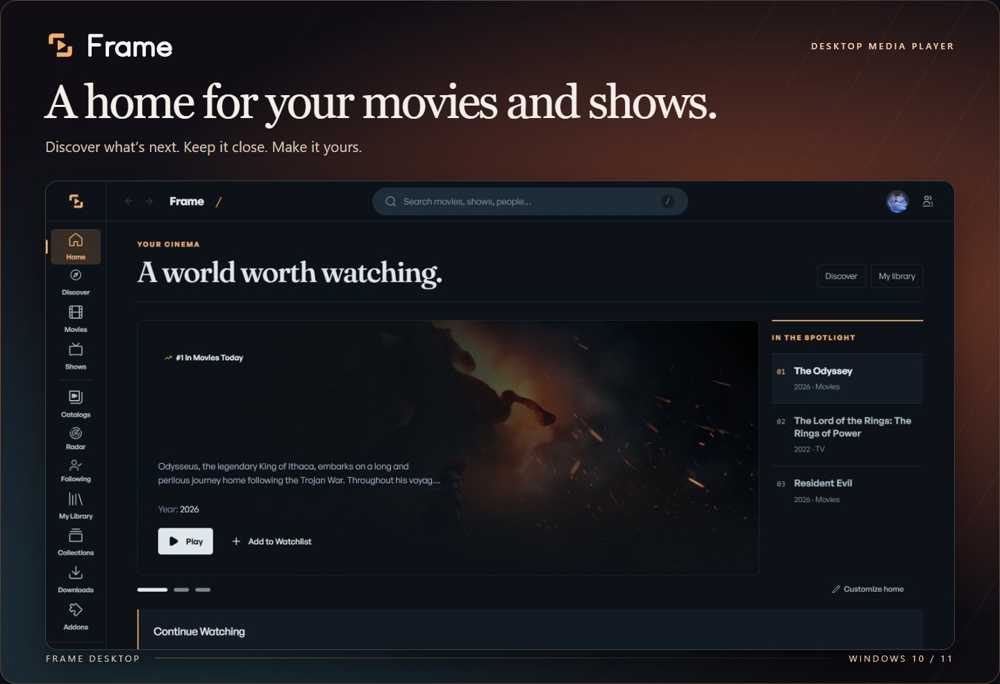
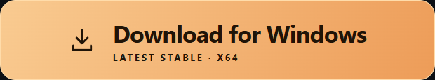
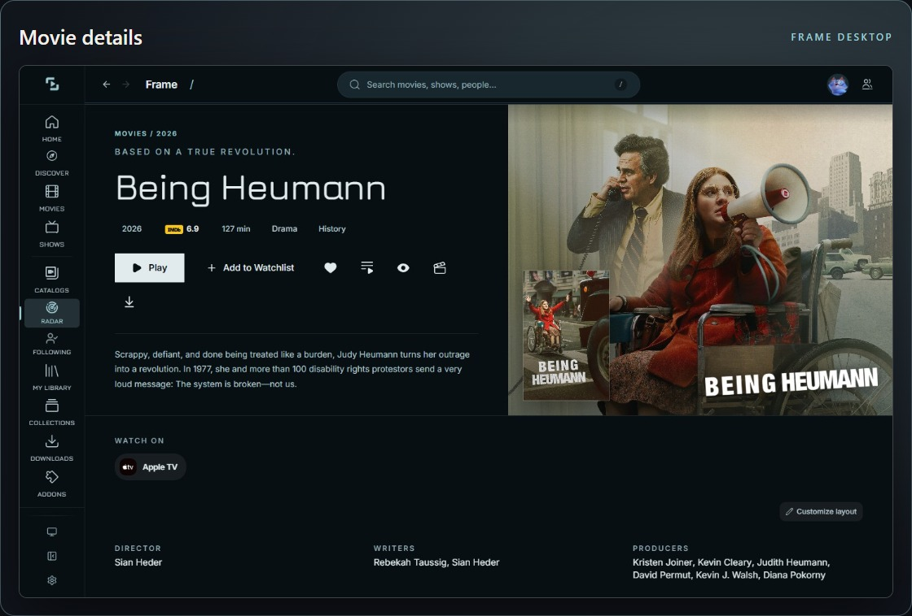
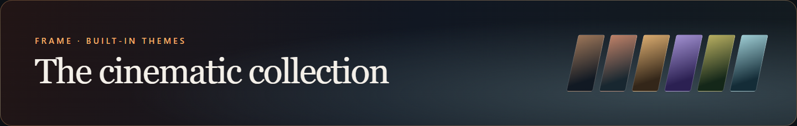
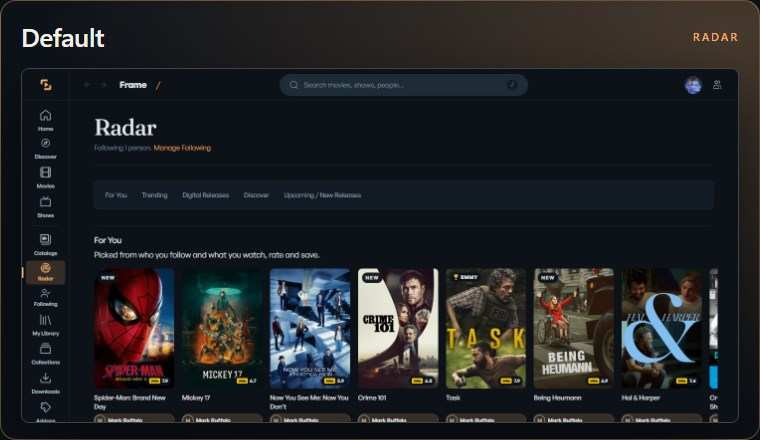
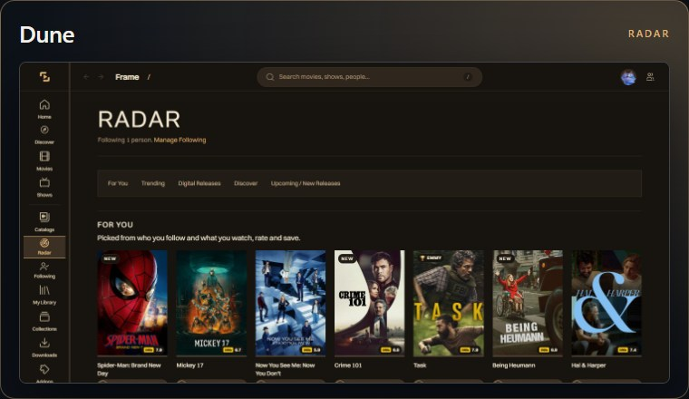
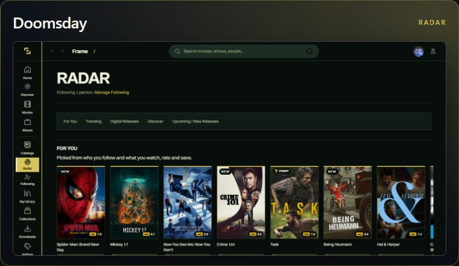
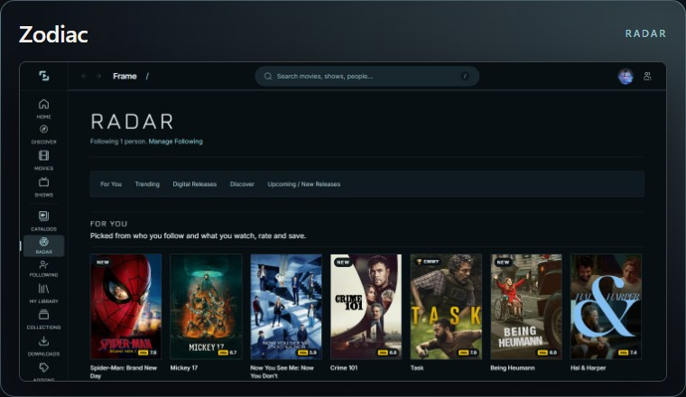
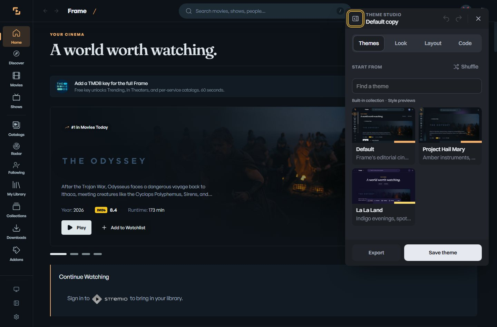

<div align="center">



# Frame

**A local-first Windows desktop app for organizing and watching the movies and TV shows you keep on your own drives.**

<a href="https://github.com/A67med/Frame/releases/latest"></a>

Windows 10 / 11 · x64 · Signed in-app updates

[Explore the app](#inside-frame) · [Browse themes](#cinematic-themes) · [Get Frame](#get-frame) · [Build from source](#build-from-source)

</div>

## Inside Frame

### From discovery to playback

Bring your local movies and episodes together in Frame, then browse Home, Discover and search to organize titles in My Library, Watchlist or Collections. Playback uses **libmpv**, with subtitles, resume and picture-in-picture. Online metadata, optional Stremio add-ons and tracking integrations can extend the experience; your local video files stay on your drive.

<a href="docs/media/showcase/details.jpg"></a>

### Follow the people behind the films

Follow your favorite actors and directors. Radar brings their work together, and **Digital Releases** shows verified Egyptian digital dates from TMDB. Browse by month and see which people you follow are connected to each release.

<a href="docs/media/showcase/radar.jpg"></a>

## Cinematic themes



Six themes change the typography, navigation, spacing and shape of the interface. The same Radar view shows how each one looks.

| Default                                                                                                                                                                     | Project Hail Mary                                                                                                                                                                                                 |
| :-------------------------------------------------------------------------------------------------------------------------------------------------------------------------- | :---------------------------------------------------------------------------------------------------------------------------------------------------------------------------------------------------------------- |
| <a href="docs/media/showcase/frame.jpg"></a> | <a href="docs/media/showcase/project-hail-mary.jpg"></a> |
| Editorial type and a compact graphite rail.                                                                                                                                 | Floating navigation, slate panels and amber controls.                                                                                                                                                             |

| Dune                                                                                                                                                                               | La La Land                                                                                                                                                                                      |
| :--------------------------------------------------------------------------------------------------------------------------------------------------------------------------------- | :---------------------------------------------------------------------------------------------------------------------------------------------------------------------------------------------- |
| <a href="docs/media/showcase/dune.jpg"></a> | <a href="docs/media/showcase/la-la-land.jpg"></a> |
| Wide spacing, angular cards and copper rules.                                                                                                                                      | Indigo surfaces, arched posters and italic serif titles.                                                                                                                                        |

| Doomsday                                                                                                                                                                                  | Zodiac                                                                                                                                                                                       |
| :---------------------------------------------------------------------------------------------------------------------------------------------------------------------------------------- | :------------------------------------------------------------------------------------------------------------------------------------------------------------------------------------------- |
| <a href="docs/media/showcase/doomsday.jpg"></a> | <a href="docs/media/showcase/zodiac.jpg"></a> |
| Green-black surfaces, heavy titles and gold selection.                                                                                                                                    | Geometric Jura lettering, silver accents and fine rules.                                                                                                                                     |

### Design your own

Open **Settings → Appearance → Your themes** to get to Theme Studio. Preview colors, typography, layout and spacing as you work. Save a custom theme or share it as a `.framestyle` file.

<a href="docs/media/showcase/studio.jpg"></a>

## Get Frame

**[Download the latest Windows x64 installer](https://github.com/A67med/Frame/releases/latest)**. The installer bundles playback dependencies. Frame checks GitHub for cryptographically signed in-app updates.

### Quick start

1. Install and open Frame on Windows 10 or 11 (x64).
2. Add your own movies or episodes using Frame's local media/library controls. Your video files stay on your device.
3. Optionally connect TMDB for richer discovery and follow-up metadata, or enable other integrations from Settings.

Frame is a **desktop app, not a streaming subscription service**. Metadata and optional integrations can contact their respective online services; local media playback does not require uploading your files.

<details>
<summary><strong>Set up metadata and optional integrations</strong></summary>

Add a TMDB API key in **Settings → Sources & library → Library & metadata** to enable Radar and Following metadata. Digital Releases depends on TMDB’s Egyptian records, which can be incomplete. You can connect Stremio or trackers from Settings and pair an optional phone remote under **Sources & library → P2P & servers**.

Use **Backup & restore** to export your settings and app data. Video files stay on your drive.

</details>

## Build from source

<details>
<summary><strong>Windows prerequisites and commands</strong></summary>

Install Node.js, pnpm, Rust, the Windows MSVC toolchain, CMake and Git Bash. Java extension tooling also requires a JDK.

```sh
pnpm install
pnpm run setup
pnpm tauri dev
```

Run `pnpm run typecheck` and `pnpm test` to check changes. Use `pnpm tauri build --bundles nsis` to create an installer under `src-tauri/target/release/bundle/nsis/`.

</details>

<div align="center">

**Tauri 2 · React · TypeScript · Rust · libmpv**

[Releases](https://github.com/A67med/Frame/releases) · [Report an issue](https://github.com/A67med/Frame/issues) · [Contributing](CONTRIBUTING.md) · [Security](SECURITY.md) · [Architecture](docs/ARCHITECTURE.md) · [MIT License](LICENSE)

<sub>Application screenshots use a demo profile. Film artwork and metadata are supplied by TMDB and other catalog providers.</sub>

</div>
