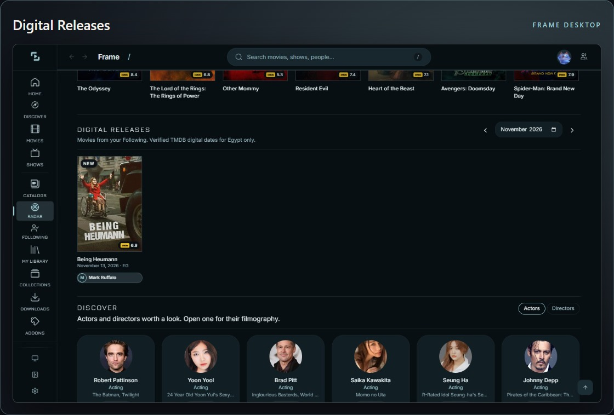
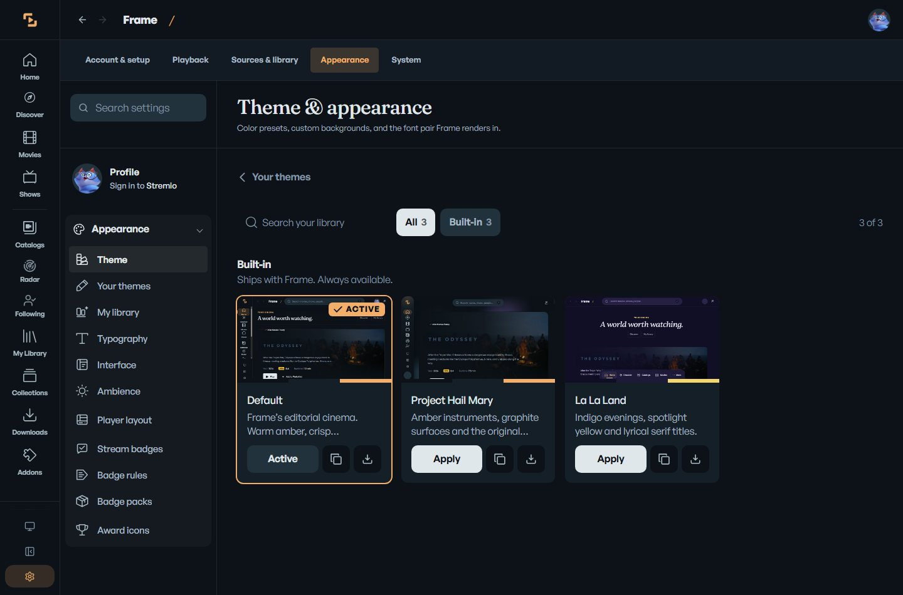
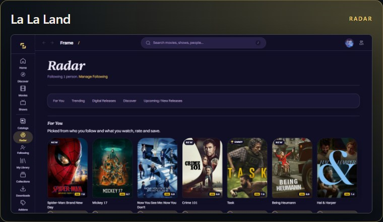

<div align="center">


# Frame

**A local-first Windows desktop app for organizing and watching the movies and TV shows you keep on your own drives.**

<a href="https://github.com/A67med/Frame/releases/latest"></a>

Windows 10 / 11 · x64 · Signed in-app updates

[Explore the app](#inside-frame) · [Browse themes](#cinematic-themes) · [Get Frame](#get-frame) · [Build from source](#build-from-source)

</div>

## Inside Frame

### From discovery to playback

Bring your local movies and episodes together in Frame, then browse Home, Discover and search to organize titles in My Library, Watchlist or Collections. Playback uses **libmpv**, with subtitles, resume and picture-in-picture. Online metadata, optional Stremio add-ons and tracking integrations can extend the experience; your local video files stay on your drive.

### Discover, follow, and organize

- **Radar** brings together personalized For You picks, weekly trends, popular movies and shows, and a release calendar. Digital Releases shows verified Egyptian dates and credits the people you follow.
- **Following** gives actors and directors their own workspace. Search for people, choose which roles to follow, and see their recent and upcoming work.
- **Global Search** surfaces a top match and keeps recent queries. **My Library** adds clearer filters, sorting, and empty states for saved titles and watch history.

| Radar                                                                                                                         | Following                                                                                                                   |
| ----------------------------------------------------------------------------------------------------------------------------- | --------------------------------------------------------------------------------------------------------------------------- |
|  |  |


## Cinematic themes

| Default                                             | Project Hail Mary                                                                                              | La La Land                                                                                                            |
| --------------------------------------------------- | -------------------------------------------------------------------------------------------------------------- | --------------------------------------------------------------------------------------------------------------------- |
| Editorial typography and a compact navigation rail. | [Rounded floating navigation](docs/media/showcase/project-hail-mary.jpg) with slate panels and amber controls. | Indigo surfaces, gold accents, italic serif titles, and a floating bottom dock that stays in place while you edit it. |





### Design your own

Open **Settings → Appearance → Your themes** to get to Theme Studio. Preview colors, typography, layout and spacing as you work. Save your own themes or import and export `.framestyle` files. **Recently Added** keeps previously selected background images available for reuse across sessions.


## Get Frame

**[Download the latest Windows x64 installer](https://github.com/A67med/Frame/releases/latest)**. The installer bundles playback dependencies. Frame checks GitHub for cryptographically signed in-app updates.

### Quick start

1. Install and open Frame on Windows 10 or 11 (x64).
2. Add your own movies or episodes using Frame's local media/library controls. Your video files stay on your device.
3. Optionally connect TMDB for richer discovery and follow-up metadata, or enable other integrations from Settings.

Frame is a **desktop app, not a streaming subscription service**. Metadata and optional integrations can contact their respective online services; local media playback does not require uploading your files.

<details>
<summary><strong>Set up metadata and optional integrations</strong></summary>

Add a TMDB API key in **Settings → Sources & library → Library & metadata** to enable Radar and Following metadata. Digital Releases depends on TMDB’s Egyptian records, which can be incomplete. You can connect Stremio or trackers from Settings and pair an optional phone remote under **Sources & library → P2P & servers**.

Use **Backup & restore** to export your settings and app data. Video files stay on your drive.

</details>

## Build from source

<details>
<summary><strong>Windows prerequisites and commands</strong></summary>

Install Node.js, pnpm, Rust, the Windows MSVC toolchain, CMake and Git Bash. Java extension tooling also requires a JDK.

```sh
pnpm install
pnpm run setup
pnpm tauri dev
```

Run `pnpm run typecheck` and `pnpm test` to check changes. Use `pnpm tauri build --bundles nsis` to create an installer under `src-tauri/target/release/bundle/nsis/`.

</details>

<div align="center">

**Tauri 2 · React · TypeScript · Rust · libmpv**

[Releases](https://github.com/A67med/Frame/releases) · [Report an issue](https://github.com/A67med/Frame/issues) · [Contributing](CONTRIBUTING.md) · [Security](SECURITY.md) · [Architecture](docs/ARCHITECTURE.md) · [MIT License](LICENSE)

<sub>Application screenshots use a demo profile. Film artwork and metadata are supplied by TMDB and other catalog providers.</sub>

</div>
