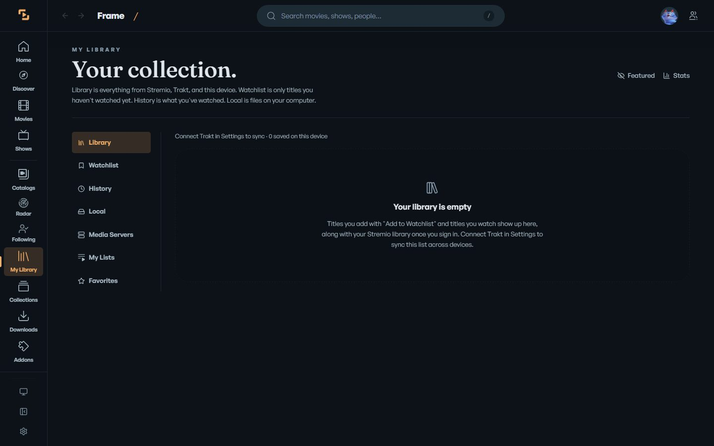
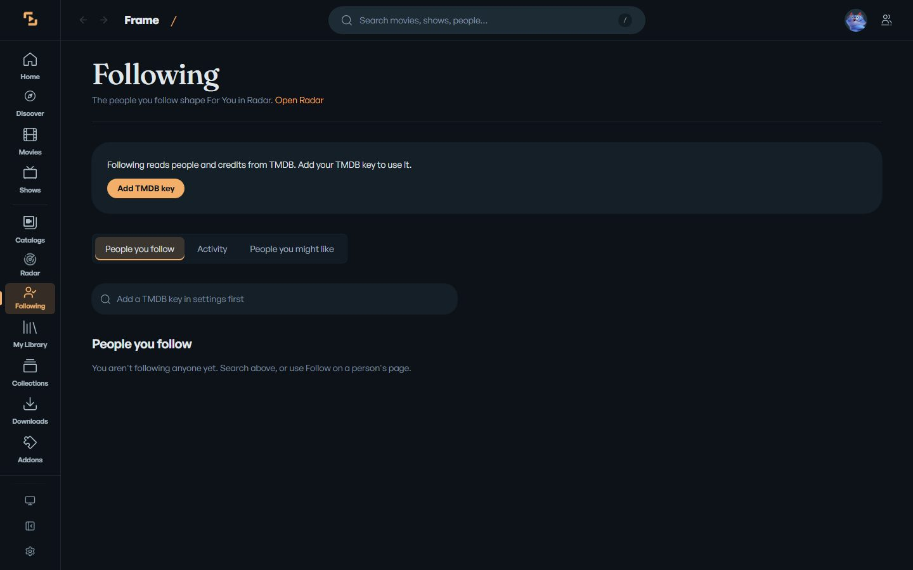
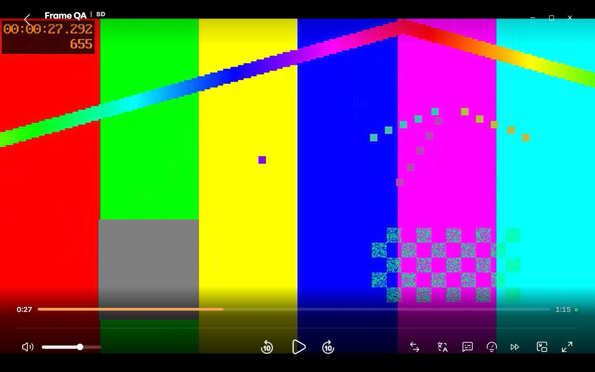
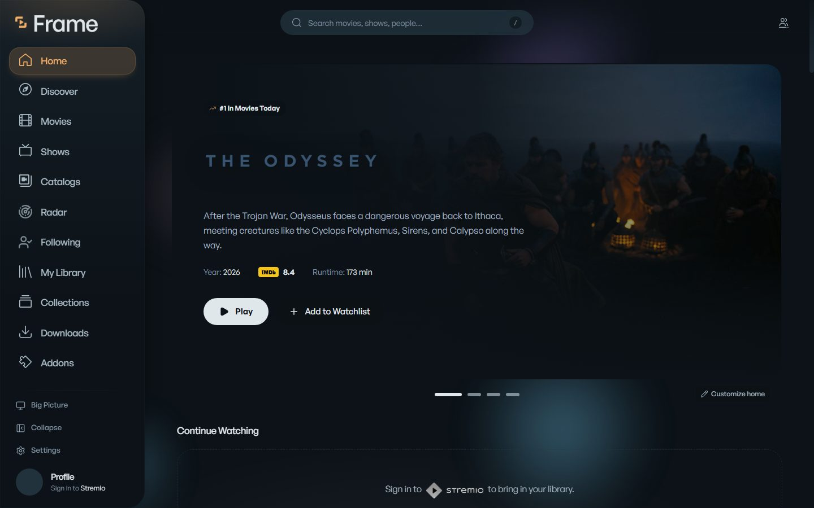

<div align="center">


# Frame

**Your movies and TV shows, on your own drives.**

Frame brings your folders, watch history and collections into a Windows desktop library. Open a local video, pick your audio and subtitles, and resume the next episode where you left it.

[**Download for Windows x64**](https://github.com/A67med/Frame/releases/latest) · [Library](#your-library) · [Playback](#in-the-player) · [Themes](#theme-studio) · [Development](#development)

[](docs/media/showcase/frame.jpg)

[](#install)
[](#in-the-player)
[](LICENSE)

</div>

## Your library

Open **My Library → Local** and add a folder of films or episodes. Watchlist keeps the titles you plan to see, History keeps the ones you started, and Collections lets you group titles yourself. Profiles keep viewing histories separate on a shared computer.

[](docs/media/showcase/library.jpg)

<details>
<summary><strong>Explore discovery and following</strong></summary>

Connect TMDB in Settings to browse Radar, look up cast and directors, and follow their upcoming work. Digital Releases uses verified digital dates for Egypt. Movies and TV series, including anime, can also use optional metadata, tracker and video add-on integrations.

| Radar                                                                                             | Following                                                                                                   |
| ------------------------------------------------------------------------------------------------- | ----------------------------------------------------------------------------------------------------------- |
| [](docs/media/showcase/radar.jpg) | [](docs/media/showcase/following.jpg) |

</details>

## In the player

Open a video from the local library or Windows Explorer. The desktop player uses libmpv for decoding, seeking and track changes. Select an embedded audio track, load a subtitle file, adjust its timing or switch to picture-in-picture. Resume and episode history belong to the active profile.

<details>
<summary><strong>See the playback controls</strong></summary>

[](docs/media/showcase/windows-player.jpg)

Captured in Frame on Windows with a generated H.264 test clip playing through embedded libmpv. The timeline, audio tracks and subtitle controls are visible.

</details>

## Theme Studio

Start with a preset, then open **Settings → Appearance → Your themes** to change colors, typography, spacing and navigation. Export a composition as a `.framestyle` file to use it on another installation. Existing `.harborstyle` themes remain readable.

| Project Hail Mary                                                                                                  | La La Land                                                                                    |
| ------------------------------------------------------------------------------------------------------------------ | --------------------------------------------------------------------------------------------- |
| [](docs/media/showcase/project-hail-mary.jpg) | [](docs/media/showcase/la-la-land.jpg) |

[](docs/THEME-STUDIO.md)

## Install

1. On Windows 10 or 11 x64, open the [latest release](https://github.com/A67med/Frame/releases/latest) and download the x64 setup executable.
2. Run the installer under the Windows account that will use Frame. The installer includes the native media engine and its sidecars. The interface runs in Microsoft Edge WebView2.
3. Open Frame and choose a media folder. Enable online metadata or add-ons in Settings if you want them.

Frame checks for signed updates. For an existing installation, use Settings’ backup and restore controls to keep a portable copy of your configuration.

## Development

The interface is React and TypeScript. Tauri connects it to Rust for folder scanning, playback, subtitles and Windows integration. The Capstan extension bridge runs on the desktop for compatible video sources.

<details>
<summary><strong>Build the Windows x64 application</strong></summary>

Install Node.js 24, the pnpm version in `package.json`, stable Rust for `x86_64-pc-windows-msvc`, Visual Studio C++ Build Tools with the Windows SDK, CMake, Git Bash and a JDK for extension tooling.

```powershell
pnpm install --frozen-lockfile
pnpm run setup
pnpm run typecheck
pnpm test
pnpm tauri build --target x86_64-pc-windows-msvc --bundles nsis
node scripts/verify-windows-bundle.mjs --require-capstan
```

The installer is written to `src-tauri/target/x86_64-pc-windows-msvc/release/bundle/nsis/`. For development, `pnpm tauri dev` starts the native host and interface together. Use a separate Windows test account when exercising upgrades or changing persistent settings.

</details>

[Architecture](docs/ARCHITECTURE.md) · [Theme Studio](docs/THEME-STUDIO.md) · [Contribution guide](CONTRIBUTING.md) · [Release process](docs/RELEASING.md) · [Report an issue](https://github.com/A67med/Frame/issues) · [Security](SECURITY.md)

Frame builds on the original Harbor project. The application is distributed under the [MIT license](LICENSE). Bundled components retain their [third-party notices](src-tauri/THIRD-PARTY-NOTICES.txt). Product screenshots use a demo profile. Artwork belongs to its respective rights holders.
